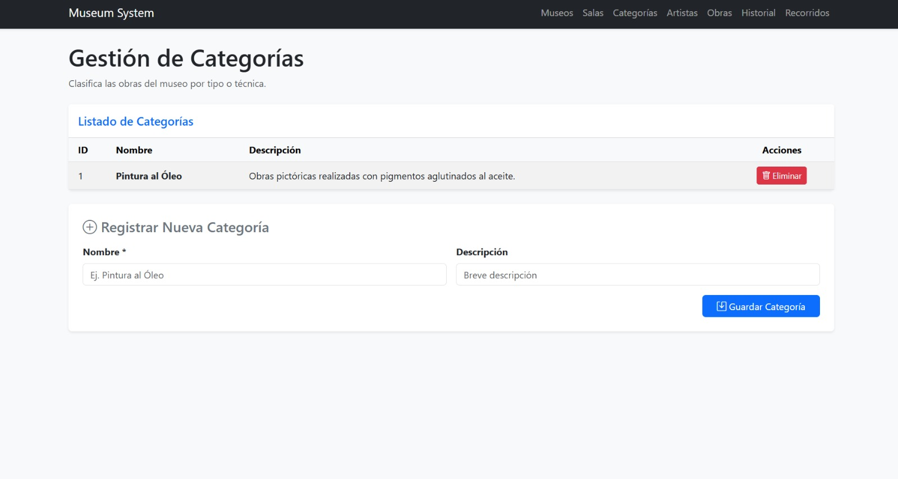
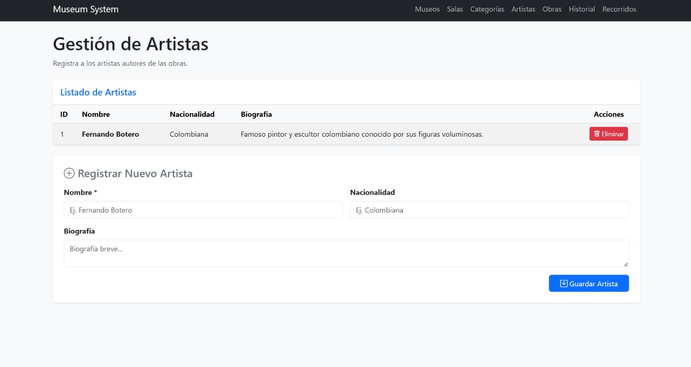

# Museum System — Sistema de Gestión de Museos

Proyecto académico de primer semestre desarrollado en **Java 17** con **Quarkus**, **Hibernate ORM / Panache**, **Qute** y **MySQL**, enfocado en el registro y consulta de museos, salas de exposición, artistas, categorías, artefactos y recorridos.

---

## 📋 Descripción del proyecto

`museum-system` es una aplicación web backend desarrollada como proyecto universitario para gestionar la información principal de un sistema de museos. Incluye:

- **Gestión de museos desde interfaz web (`museums.html`):** listado, registro mediante formulario y eliminación de museos en `/museos`.
- **Modelo de dominio relacional (JPA / Hibernate):** entidades para `Museum`, `ExhibitionRoom`, `Artist`, `Category`, `Artifact`, `ExhibitionHistory`, `Tour` y `TourRoom`.
- **Carga inicial automática de datos (`DataInitializer.java`):** inserta datos de ejemplo al iniciar la aplicación si aún no existen museos registrados[cite: 1].
- **Endpoint de prueba (`GreetingResource.java`):** ruta `/hello` para comprobar que el servidor está respondiendo[cite: 1].

---

## 📸 Capturas de Pantalla

### Gestión de Categorías
<p align="center">
  
</p>

### Gestión de Artistas
<p align="center">
  
</p>

---

## 🛠️ Tecnologías utilizadas

| Componente | Tecnología / Librería | Uso en el proyecto |
| :--- | :--- | :--- |
| **Lenguaje** | Java 17 | Desarrollo de entidades, controladores y repositorios[cite: 1] |
| **Framework Web** | Quarkus (`3.40.1.2`) + RESTEasy | Rutas HTTP, inyección de dependencias y ejecución rápida[cite: 1] |
| **Persistencia** | Hibernate ORM + Panache + JDBC MySQL | Mapeo objeto-relacional y acceso a datos en MySQL[cite: 1] |
| **Plantillas HTML** | Qute + Bootstrap 5 | Renderizado de la vista web `museums.html`[cite: 1] |
| **Gestor de compilación** | Apache Maven (`./mvnw` / `.\mvnw.cmd`) | Compilación, pruebas y ejecución del proyecto[cite: 1] |

---

## 📁 Estructura del proyecto

```text
museum-system/
├── docs/
│   ├── gestion-artistas.jpeg
│   └── gestion-categorias.jpeg
├── src/
│   ├── main/
│   │   ├── java/com/museum/
│   │   │   ├── controller/
│   │   │   │   └── MuseumResource.java       # Rutas /museos (GET, POST, eliminar)
│   │   │   ├── model/
│   │   │   │   ├── Artifact.java             # Artefactos y estado de conservación
│   │   │   │   ├── Artist.java               # Artistas y nacionalidad
│   │   │   │   ├── Category.java             # Categorías de obras/artefactos
│   │   │   │   ├── ExhibitionHistory.java    # Historial de piezas en salas
│   │   │   │   ├── ExhibitionRoom.java       # Salas de exposición y capacidad
│   │   │   │   ├── Museum.java               # Entidad principal de museo
│   │   │   │   ├── Tour.java                 # Recorridos y fechas
│   │   │   │   └── TourRoom.java             # Orden de salas dentro de un tour
│   │   │   ├── repository/
│   │   │   │   └── MuseumRepository.java     # Repositorio Panache para Museum
│   │   │   ├── DataInitializer.java          # Datos iniciales al arrancar
│   │   │   └── GreetingResource.java         # Endpoint de prueba /hello
│   │   └── resources/
│   │       ├── templates/
│   │       │   └── museums.html              # Interfaz web con Qute y Bootstrap
│   │       ├── application.properties        # Conexión MySQL y puerto configurado
│   │       └── import.sql                    # Script SQL auxiliar
│   └── test/java/com/museum/
│       ├── GreetingResourceTest.java         # Prueba unitaria/de integración
│       └── GreetingResourceIT.java           # Prueba empaquetada
├── pom.xml                                   # Dependencias y configuración Maven
└── mvnw / mvnw.cmd                           # Maven Wrapper